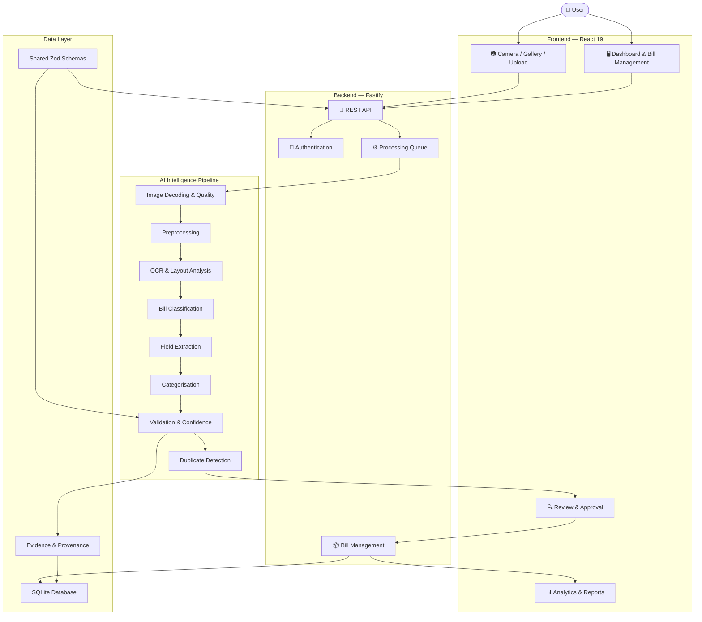
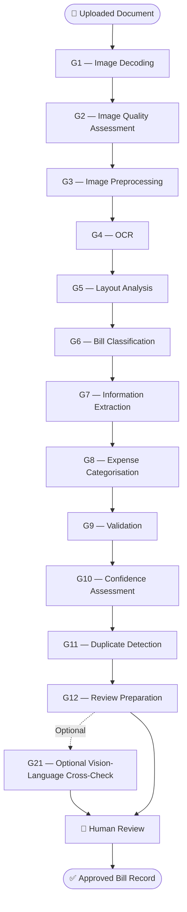

 
# 🚀 BillKit — Every Bill, in Your Pocket.

<div align="center">


<br/>

**An intelligent, evidence-first bill scanning and expense management platform.**

Transform paper bills and digital receipts into structured, searchable and verifiable financial records.

<br/>

[](https://github.com/gousekareem/BillKit)
[](https://react.dev/)
[](https://www.typescriptlang.org/)
[](https://nodejs.org/)
[](LICENSE_OR_OWNERSHIP.md)

<br/>

[**Explore the Repository**](https://github.com/gousekareem/BillKit) · [**Getting Started**](#-getting-started) · [**Architecture**](#-system-architecture) · [**Evaluation**](#-evaluation--testing)

<br/>


</div>

---

## ✨ 01. Introduction

**BillKit** is an AI-assisted bill intelligence and expense management application designed to simplify how people capture, understand, validate and organise financial documents.

A user photographs or uploads a bill. BillKit processes the document through a multi-stage intelligence pipeline, extracts relevant information, validates the results and presents the findings for human review.

Unlike systems that blindly trust OCR or AI predictions, BillKit follows an **evidence-first processing philosophy**.

Every extracted value is associated with its supporting text. Missing information stays missing. Uncertain information is clearly highlighted. Corrections made by users take precedence over automated predictions.

### The BillKit philosophy

> Accuracy over assumptions. Evidence over guesses. Transparency over artificial confidence. Human approval over blind automation.

<div align="center">

| 📷 Capture | 🧠 Understand | 🔍 Validate | ✅ Approve |
|:---:|:---:|:---:|:---:|
| Upload bills | Extract information | Verify results | Save records |
| Image processing | OCR + AI | Rules + evidence | Human review |

</div>

---

## 🎯 02. Why BillKit?

Traditional receipt management is often manual, repetitive and error-prone.

BillKit combines document processing, OCR, validation, categorisation and financial analytics into one connected workflow.

| Challenge | BillKit approach |
|---|---|
| Poor-quality photographs | Image quality assessment and preprocessing |
| Images that are not receipts | Bill/non-bill classification |
| Unstructured receipt text | OCR and layout analysis |
| Incorrect extracted values | Evidence-linked extraction and validation |
| Uncertain predictions | Explicit confidence states |
| Incorrect arithmetic | Total and calculation checks |
| Duplicate receipts | Duplicate detection and warnings |
| Disorganised expenses | Categories, search and filtering |
| Limited financial visibility | Analytics, budgets and unusual-expense flags |
| Blind AI automation | Mandatory user review and approval |

---

## ⚡ 03. Core Features

### 📸 Intelligent Document Capture

- Camera-based bill capture.
- Gallery and drag-and-drop uploads.
- Image rotation, cropping and replacement.
- Upload progress and cancellation.
- JPG, PNG, WebP, HEIC and multi-page PDF support.
- Image quality assessment.
- Perspective correction, deskewing and shadow correction.
- Automatic OCR orientation handling.

### 🧠 AI-Assisted Intelligence

- Tesseract OCR.
- Document layout analysis.
- Bill and non-bill classification.
- Merchant and date extraction.
- Total and currency extraction.
- Extraction of 18 additional fields.
- Automatic expense categorisation.
- Confidence and uncertainty handling.
- Duplicate detection.
- Optional vision-language cross-check using Anthropic.

### 🔍 Evidence-Based Verification

- Extracted values linked to supporting text.
- Field-level validation.
- Arithmetic consistency checks.
- Explicit uncertainty indicators.
- Missing values remain empty.
- Mandatory confirmation of flagged fields.
- User corrections and provenance tracking.
- Human approval before saving.

### 📊 Expense Management

- Personal expense dashboard.
- Bill history.
- Search, filtering, sorting and pagination.
- Bill detail and editing.
- Custom expense categories.
- Analytics and budgets.
- Unusual-expense flags.
- CSV and JSON exports.

### 🔐 Account and Administration

- User registration and authentication.
- Login and logout.
- Password change.
- Account deletion.
- Settings management.
- Administrative metrics.
- Admin role management.
- Contact form.
- Password-reset infrastructure.

### 📱 Progressive Web Application

BillKit is designed as a Progressive Web App (PWA).

- Installable on supported devices.
- Responsive user interface.
- Offline viewing capabilities.
- Mobile-friendly document capture.
- Connected public website and authenticated application.

---

## 🏗️ 04. System Architecture

BillKit follows a modular architecture separating the frontend, backend, AI processing pipeline and shared validation layer.



### Technology Stack

<div align="center">

| Layer | Technologies |
|---|---|
| Frontend | React 19, TypeScript |
| UI & Build | Vite |
| Backend | Node.js, Fastify |
| Database | SQLite, better-sqlite3 |
| Validation | Zod |
| OCR | Tesseract |
| Image Processing | Sharp and preprocessing pipeline |
| AI Integration | Optional Anthropic vision-language model |
| Testing | Vitest, Playwright, axe-core |
| Python Tooling | Python 3.11+, pytest |
| Application Delivery | Progressive Web App |

</div>

---

## 🤖 05. AI Processing Pipeline

BillKit uses a multi-stage processing architecture rather than relying on a single AI model.

### Processing workflow



### Intelligence principles

| Principle | Implementation |
|---|---|
| Evidence | Values are associated with source text |
| Transparency | Uncertain values are highlighted |
| Conservative extraction | Missing information is not fabricated |
| Validation | Business rules and arithmetic checks |
| Human control | Approval before saving |
| Traceability | Corrections and provenance are maintained |
| Honest confidence | Scores are heuristic until calibrated |

**Important:** Confidence scores are currently heuristic and must not be interpreted as statistically calibrated probabilities.

---

## 📁 06. Repository Structure

```text
BillKit/
│
├── website/                 # React 19 frontend and PWA
│   ├── src/
│   └── public/
│
├── backend/                 # Fastify REST API
│
├── ai/                      # AI and OCR processing pipeline
│
├── packages/
│   └── shared/              # Shared Zod schemas and rules
│
├── database/
│   └── migrations/          # SQLite migrations
│
├── evaluation/
│   ├── synthetic_smoke/
│   └── results/
│
├── dataset/
│   └── hr_assignment/       # HR evaluation dataset framework
│
├── training/                # Python ML tooling
│
├── diagrams/                # Mermaid sources and rendered diagrams
│
├── docs/                    # Technical documentation
│   └── technical/           # 23 technical explainers
│
├── presentation/            # Presentation and visual assets
│
├── submission/              # Demo and submission materials
│
├── assets/                  # Logos, icons and screenshots
│
├── package.json
├── package-lock.json
├── .env.example
└── README.md
```

---

## 🚀 07. Getting Started

### Prerequisites

| Requirement | Version |
|---|---|
| Node.js | 22.12 or newer |
| npm | 10 or newer |
| Python | 3.11+ (training only) |
| Git | Latest recommended |

### 1. Clone the repository

```bash
git clone https://github.com/gousekareem/BillKit.git
cd BillKit
```

### 2. Install dependencies

```bash
npm ci
```

Native dependencies such as `better-sqlite3`, `sharp` and `argon2` may require platform-specific build support.

**Windows:** If native compilation fails, install Visual Studio Build Tools with the Desktop development with C++ workload.

### 3. Configure environment

```bash
cp .env.example .env
```

On Windows Command Prompt:

```cmd
copy .env.example .env
```

The default environment configuration supports local development.

### 4. Start the application

**macOS / Linux:**

```bash
npm run dev
```

**Windows:**

Open two terminals.

Terminal 1 — Backend:

```bash
npm run dev -w backend
```

Terminal 2 — Frontend:

```bash
npm run dev -w website
```

### 5. Open BillKit

<div align="center">

### 🌐 http://localhost:5173

Create an account, open the scanning interface, upload a bill and review the extracted information.

</div>

---

## 🏭 08. Production Build

Build the application:

```bash
npm run build
```

The production output includes:

- `backend/dist/server.js`
- `website/dist/`

Run the application as a single server.

**macOS / Linux:**

```bash
APP_ENV=production \
STATIC_DIR=$PWD/website/dist \
PUBLIC_ORIGIN=https://your-domain \
COOKIE_SECURE=true \
node backend/dist/server.js
```

**Windows PowerShell:**

```powershell
$env:APP_ENV="production"
$env:STATIC_DIR="$PWD\website\dist"
$env:PUBLIC_ORIGIN="https://your-domain"
$env:COOKIE_SECURE="true"

node backend/dist/server.js
```

For deployment requirements, HTTPS and hosting configuration, see the deployment documentation.

---

## 🧪 09. Evaluation & Testing

Testing is an important part of BillKit's development.

### Current test coverage

<div align="center">

| Test Suite | Reported Result |
|---|---:|
| Unit and integration tests | 136 passing |
| Playwright end-to-end tests | 11 passing |
| Python tests | 10 passing |
| Synthetic smoke evaluation | 15 generated images |

</div>

These are the reported project test results; rerun the commands against the current checkout to independently verify them.

### Run all checks

```bash
npm run check
```

This runs linting, type checking, tests and the production build.

### Run tests separately

```bash
npm test
```

### Browser end-to-end tests

```bash
npm run build
npx playwright install chromium
npm run test:e2e
```

Alternatively, set `CHROME_PATH` to an existing Chrome installation.

### Python tests

```bash
python -m venv .venv
```

Activate the environment.

Windows:

```cmd
.venv\Scripts\activate
```

macOS / Linux:

```bash
source .venv/bin/activate
```

Install requirements:

```bash
pip install -r training/requirements.txt
```

Run:

```bash
python -m pytest training/tests
```

---

## 📊 10. HR 20-Image Evaluation

BillKit includes a dedicated evaluation harness for testing against a real-world 20-image dataset.

### Dataset composition

| Document Type | Required Images |
|---|---:|
| Real bills | 15 |
| Non-bills | 5 |
| **Total** | **20** |

### Required directory structure

```text
dataset/
└── hr_assignment/
    │
    ├── 15_real_bill_images/
    │   ├── B01.jpg
    │   ├── B02.jpg
    │   ├── ...
    │   └── B15.jpg
    │
    ├── 05_non_bill_images/
    │   ├── N01.jpg
    │   ├── N02.jpg
    │   ├── ...
    │   └── N05.jpg
    │
    └── ground_truth.csv
```

### Ground truth annotation

Complete `ground_truth.csv` using the original paper bills.

Required information includes:

- Merchant
- Date (`YYYY-MM-DD`)
- Total
- Currency
- Category

### Execute evaluation

```bash
npm run eval:hr
```

For US-style month-first dates:

```bash
npm run eval:hr -- --date-order MDY
```

### Generated reports

```text
evaluation/
└── results/
    └── hr_assignment/
        ├── report.md
        ├── predictions.csv
        └── metrics.json
```

**Evaluation status:** The real-world HR evaluation framework is implemented, but the actual 20-image dataset remains pending. Therefore, no real-world accuracy result is claimed.

### Synthetic smoke evaluation

```bash
npm run fixtures:synthetic
npm run eval:smoke
```

The existing synthetic smoke evaluation completed successfully on 15 computer-generated fictional images, with all expected decisions and fields matching.

This verifies the evaluation workflow and synthetic test cases. It is not evidence of equivalent real-world accuracy.

---

## 🔌 11. Optional Integrations

### Anthropic Vision-Language Cross-Check

BillKit supports an optional cloud-based vision-language cross-check.

Configure the following in `.env`:

```env
AI_PROVIDER=anthropic
AI_PROVIDER_API_KEY=your_api_key
AI_MODEL=your_supported_model
```

Restart the application and enable **Use cloud vision** in Settings.

**Privacy and cost considerations:**

- API usage may incur charges.
- Bill images are transmitted to Anthropic when the feature is used.
- Users must explicitly enable the feature.
- The application remains functional without this integration.

### Email Configuration

Password-reset and contact email functionality can be configured using:

```env
SMTP_*
CONTACT_TO_EMAIL
```

Without SMTP configuration, development password-reset links are printed to the server console, and contact messages are stored in the database.

---

## 🛠️ 12. Useful Commands

| Command | Purpose |
|---|---|
| `npm ci` | Install dependencies |
| `npm run dev` | Start development servers |
| `npm run build` | Build production application |
| `npm test` | Run test suites |
| `npm run check` | Run full project checks |
| `npm run lint` | Run ESLint |
| `npm run typecheck` | Run TypeScript checks |
| `npm run test:e2e` | Run browser tests |
| `npm run eval:hr` | Execute HR evaluation |
| `npm run eval:smoke` | Execute synthetic evaluation |
| `npm run fixtures:synthetic` | Generate synthetic images |
| `npm run diagrams:render` | Render Mermaid diagrams |
| `npm run admin:grant -- email@example.com` | Grant admin privileges to an existing account |

---

## ⚠️ 13. Project Status & Limitations

BillKit is a substantial working application, but some capabilities require additional data, credentials or environments.

| Component | Status |
|---|---|
| Authentication and account management | ✅ Implemented and tested |
| Bill scanning and upload | ✅ Implemented and tested |
| OCR and preprocessing | ✅ Implemented and tested |
| Bill classification | ✅ Implemented and tested |
| Information extraction | ✅ Implemented and tested |
| Evidence-based review | ✅ Implemented and tested |
| Expense categorisation | ✅ Implemented and tested |
| Analytics and exports | ✅ Implemented and tested |
| Admin operations | ✅ Implemented and tested |
| PWA and offline viewing | ✅ Implemented |
| Anthropic integration | ⚙️ Implemented; live API testing pending |
| SMTP integration | ⚙️ Implemented; real server testing pending |
| HR 20-image evaluation | ⏳ Dataset pending |
| Confidence calibration | ⏳ Calibration data pending |
| Image-classifier model training | ⏳ Framework only |
| Native mobile application | Not implemented; PWA provided |
| Live production deployment | Pending hosting setup |
| Safari and Firefox testing | Pending |

For the complete technical limitations, see [`docs/limitations.md`](docs/limitations.md).

---

## 📚 14. Documentation

BillKit includes dedicated documentation for architecture, development, deployment, testing and technical understanding.

| Document | Description |
|---|---|
| [Architecture](docs/architecture.md) | Overall system design |
| [AI/ML Pipeline](docs/ai_ml_pipeline.md) | AI processing architecture |
| [Setup Guide](docs/setup_guide.md) | Development environment |
| [Deployment Guide](docs/deployment_guide.md) | Production deployment |
| [Limitations](docs/limitations.md) | Known limitations |
| [Reflection](docs/reflection.md) | Project reflection |
| [Interview Preparation](docs/interview_preparation.md) | Technical interview preparation |
| [Submission Checklist](submission/submission_checklist.md) | HR submission requirements |
| [Demo Script](submission/demo_script.md) | Application demonstration |
| [Training Guide](TRAINING_GUIDE.md) | ML and dataset tooling |

Additional technical explainers are available in `docs/technical/`.

---

## 🔒 15. Security & Privacy

BillKit is designed with user trust and data integrity in mind.

Key design considerations include:

- Authentication and account isolation.
- Server-side validation.
- Controlled document processing.
- Evidence-linked extraction.
- Explicit user approval.
- Optional cloud AI rather than mandatory cloud processing.
- No hardcoded real API credentials in the repository.

**Important:** Users should never commit `.env` files, API keys, passwords, private bill photographs or other confidential information to GitHub.

---

## 🗺️ 16. Future Improvements

Potential areas for continued development include:

- Real-world OCR accuracy benchmarking.
- Statistically calibrated confidence scores.
- Licensed image-classifier training datasets.
- Expanded OCR language support.
- Live Anthropic API integration testing.
- Production hosting and deployment.
- Cross-browser testing.
- Native mobile application development.
- Enhanced financial insights and reporting.

---

## 👨‍💻 17. Developer

<div align="center">


### Shaik Gouse Kareem

**Creator & Developer of BillKit**

Building intelligent applications through software engineering, AI-assisted document processing and evidence-based automation.

<br/>

[](https://github.com/gousekareem)
[](https://github.com/gousekareem/BillKit)

</div>

---

## 📜 18. Ownership & Rights

© 2026 **Shaik Gouse Kareem. All rights reserved.**

This repository includes an ownership notice. No registration is claimed.

See [`LICENSE_OR_OWNERSHIP.md`](LICENSE_OR_OWNERSHIP.md) for the applicable ownership and usage terms.

---

<div align="center">

# 💙 Built with Purpose. Designed for Trust.

**BillKit — Every Bill, in Your Pocket.**

<br/>

[](https://github.com/gousekareem/BillKit)

<br/>


<br/>

<sub>© 2026 Shaik Gouse Kareem · All Rights Reserved</sub>

</div>
